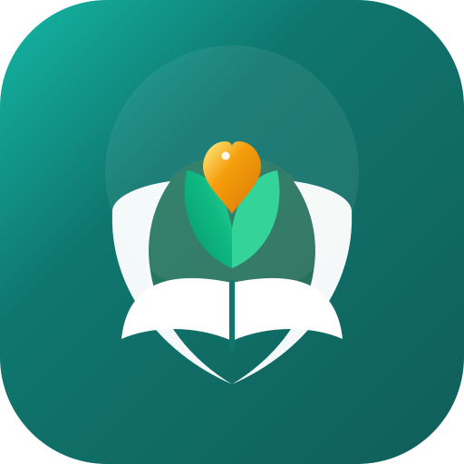
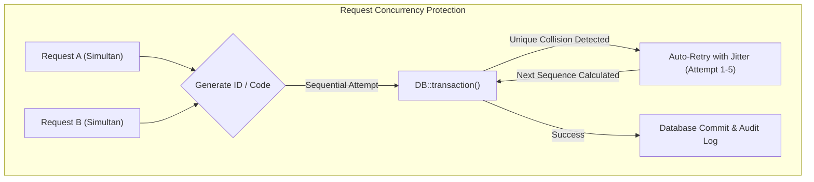

<div align="center">



# SIGAP-SR

**Sistem Informasi Pengasuhan, Pembinaan, dan Evaluasi Sekolah Rakyat**

Aplikasi web ramah anak dan berstandar produksi untuk membantu sekolah berasrama mencatat presensi, insiden, pembinaan asrama, tindak lanjut, dan laporan perlindungan anak dalam satu ruang kerja yang terbatas akses, kebal *race condition*, dan tercatat audit penuh.

[](https://www.php.net)
[](https://laravel.com)
[](https://vuejs.org)
[](https://inertiajs.com)
[](https://tailwindcss.com)
[](https://phpunit.de)
[](https://playwright.dev)
[](https://github.com/rteitch/sigap-sr)
[](LICENSE)

Dikembangkan dan dipelihara oleh **Rizal Taufiq Hidayat** · [GitHub](https://github.com/rteitch)

</div>

---

## Filosofi Logo & Identitas Ramah ("Caring & Growth")

Logo **SIGAP-SR** dirancang dengan filosofi kehangatan, pengasuhan, dan perlindungan holistik:
- **Rangkulan Asuh (Embracing Care)**: Sayap rangkulan lembut yang melingkari anak, menghadirkan rasa aman dari perundungan, kekerasan, maupun penelantaran.
- **Buku Masa Depan (Book of Growth)**: Fondasi terbuka yang melambangkan pendidikan karakter, ilmu pengetahuan, dan bimbingan guru pamong.
- **Tunas Bertumbuh (Sprout of Hope)**: Tunas daun hijau emerald yang tumbuh di tengah buku, mencerminkan potensi setiap anak yang mekar optimal.
- **Inti Hati Emas (Golden Heart of Care)**: Pusat hangat berwarna emas yang memancarkan ketulusan, kasih sayang, dan pendampingan tanpa stigma.

Logo berbentuk vektor SVG murni (`public/icon.svg`), didukung binary `public/favicon.ico` multi-resolusi riil (16×16, 32×32, 48×48 px) dan aset PWA adaptif (`icon-192.png` & `icon-512.png`).

---

## Ringkasan Fitur Unggulan

SIGAP-SR dirancang khusus untuk operasional harian sekolah berasrama dengan standar keamanan data anak:

- **Identitas Siswa, Foto & Avatar Terintegrasi**:
  - Kolom `photo_path` pada tabel `student_identities` (prinsip *Privacy by Design* — identitas langsung anak dipisahkan dari tabel operasional).
  - Unggah foto dengan validasi format (JPG, PNG, WebP maks 2MB), kompresi, dan pratinjau langsung.
  - Avatar dinamis tampil di tabel direktori siswa, form pendaftaran, profil detail santri, dan baris presensi harian.
  - Tanggal lahir terintegrasi dengan kalkulasi usia santri otomatis (misal: `14 tahun`).
- **Manajemen Guru & Tenaga Kependidikan (`/admin/users`)**:
  - Navigasi khusus **Guru & Staf** dengan tab filter cepat (*Semua Staf*, *Guru & Wali Kelas*, *Wali Asrama*, *Manajemen & TPPK*).
  - Eager-loading relasi penugasan kelas perwalian (`homeroomClasses`) dan asrama binaan (`dormAssignments`).
  - Lencana penugasan dinamis (misal: `Wali Kelas VII-A`, `Asrama Ibnu Sina`, `Bimbingan Konseling`).
- **Halaman Legal Khusus Satuan Pendidikan**:
  - **Kebijakan Privasi (`/kebijakan-privasi`)**: Kepatuhan terhadap UU No. 27/2022 (UU PDP) dan Permendikbudristek No. 46/2023 (PPKSP), hak persetujuan orang tua (*informed consent*), pseudonimisasi, dan audit trail tak terbantahkan.
  - **Persyaratan Layanan (`/persyaratan-layanan`)**: Standar etika staf, kerahasiaan data kasus anak, larangan tangkapan layar liar ke media sosial/grup perpesanan, dan integritas presensi.
- **Eliminasi Tuntas Bug Overlap Form & Dropdown**:
  - Penataan kaskade CSS Tailwind v4 melalui pemisahan `@layer components` dan `@layer utilities` beraturan `!important`.
  - Terbukti secara matematis via Playwright: jarak teks terhadap ikon input minimal 40px (bebas dari tabrakan ikon).
  - Dropdown `<select class="field">` memiliki `pr-10 cursor-pointer` sehingga teks opsi tidak tertutup panah chevron browser.
- **Manajemen Profil & Keamanan Mandiri (`/profil`)**:
  - Staf dapat memperbarui nama, nomor telepon/WhatsApp, dan mengganti kata sandi dengan verifikasi kata sandi lama serta pencatatan audit.
- **Presensi Harian Terkoneksi & Deteksi Siswa Hilang**:
  - Presensi kelas dan kegiatan asrama (apel pagi, makan, apel malam, tidur) dengan deteksi otomatis siswa tidak ditemukan (*missing student*) yang langsung dieskalasikan ke insiden darurat.
- **Manajemen Insiden & Perlindungan Anak**:
  - Pelaporan berbasis bahasa fakta teramati, 4 tingkat keparahan, jalur *sangat rahasia* (khusus Kepala Sekolah, TPPK, dan BK), checklist protokol otomatis, dan penambahan rencana aksi mandiri.
- **Pembinaan Asrama & Logbook Piket**:
  - Checklist ronde malam, logbook pergantian shift, serah terima pembina, dan catatan kejadian terstruktur.
- **Laporan Bulanan & Perlindungan Kelompok Kecil**:
  - Agregasi data dengan ambang batas (*small-group threshold*) untuk mencegah identifikasi anak secara statistik, dilengkapi fasilitas ekspor XLSX ber-audit.
- **Branding Sekolah Dinamis**:
  - Kustomisasi nama sekolah, nama aplikasi, tagline, warna utama, dan logo sekolah yang langsung tercermin secara *real-time* di seluruh antarmuka.

---

## Kesiapan Produksi & Ketahanan Konkurensi (Concurrency-Hardened)

SIGAP-SR telah diaudit dan diperkuat terhadap potensi *race condition*, anomali konkurensi, dan celah keamanan produksi:



1. **Bebas Tabrakan Kode Siswa & Nomor Insiden (`Race-Condition Free`)**:
   - Pembuatan Kode Siswa (`SR-YYYY-XXXX`) dan Nomor Kasus Insiden (`SR-YYYY-XXXX`) dilindungi oleh blok *exponential retry loop* (hingga 5 percobaan dengan jitter milidetik) yang menangkap `UniqueConstraintViolationException` secara mulus. Jika dua staf menekan tombol simpan pada milidetik yang sama, salah satu request akan otomatis mengambil nomor urut berikutnya tanpa melempar galat 500 ke pengguna.
2. **Integritas Presensi Bersamaan**:
   - Pencatatan presensi dilindungi transaksi database dengan indeks unik gabungan `['student_id', 'date', 'type']` untuk mencegah duplikasi baris kehadiran siswa pada sesi yang sama.
3. **Pemisahan Identitas Langsung (Privacy by Design)**:
   - Data foto dan identitas langsung anak disimpan terpisah di tabel `student_identities`. Data analitik operasional hanya menggunakan kode pseudonim.
4. **Proteksi Akses Bertingkat (Defense in Depth)**:
   - Insiden tingkat keparahan tinggi (*severity 3-4*) dan kasus berlabel *sangat rahasia* hanya dapat dibuka oleh peran Kepala Sekolah dan TPPK. Peran lain (termasuk administrator umum) ditolak di level Policy dan Query Scope.
5. **Rate Limiting & Perlindungan Brute-force**:
   - Endpoint login diproteksi `throttle:6,1` (maksimal 6 percobaan per menit).
   - Seluruh form dilindungi CSRF token Laravel murni.
6. **Audit Trail Tak Terbantahkan (*Immutable Audit Log*)**:
   - Setiap tindakan pengubahan profil, pembacaan identitas siswa, ekspor data, dan investigasi kasus dicatat otomatis dengan IP address, User Agent, dan cap waktu permanen.

---

## Teknologi

| Lapisan | Teknologi | Versi |
|---|---|---|
| **Backend** | PHP, Laravel Framework | PHP 8.3+, Laravel 13 |
| **Frontend** | Inertia.js, Vue 3 (Composition API), Lucide Vue | Inertia v3, Vue 3.5+ |
| **Styling** | Tailwind CSS (Cascade Layers & Custom Utility Defense) | Tailwind CSS v4 |
| **Build Tool** | Vite | Vite 8 |
| **Database** | SQLite (Pengembangan), MySQL 8+ / PostgreSQL 15+ (Produksi) | Siap RDBMS |
| **Testing** | PHPUnit (Backend Feature & Unit), Playwright (E2E & Visual) | PHPUnit 11, Playwright 1.58+ |
| **PWA** | Web App Manifest, Service Worker, Multi-res ICO | PWA Ready |

---

## Persyaratan Sistem

- PHP 8.3 atau lebih baru dengan ekstensi wajib: `pdo`, `pdo_sqlite` (atau `pdo_mysql`/`pdo_pgsql`), `mbstring`, `openssl`, `fileinfo`, `zip`, `gd`, dan `tokenizer`.
- Composer 2.
- Node.js 20 LTS atau lebih baru dan npm.
- Database: SQLite (bawaan lokal) atau MySQL 8.0+ / MariaDB 10.5+ / PostgreSQL 15+.
- Web Server Produksi: Nginx atau Caddy dengan PHP-FPM, atau Laravel Cloud / FrankenPHP.

---

## Panduan Instalasi Lokal

```bash
# 1. Klon repositori dan pasang dependensi
git clone https://github.com/rteitch/sigap-sr.git
cd sigap-sr/sigap-app
composer install
npm install

# 2. Siapkan environment file
copy .env.example .env     # Di Linux/macOS: cp .env.example .env
php artisan key:generate

# 3. Migrasi database dan isi data awal
php artisan migrate:fresh --seed

# 4. Buat symlink storage untuk upload logo dan avatar siswa
php artisan storage:link

# 5. Kompilasi aset frontend
npm run build

# 6. Jalankan server lokal
php artisan serve
```

Aplikasi dapat dibuka di `http://127.0.0.1:8000`.

### Matriks Peran & Akun Demo (Hanya Mode Lokal)

Semua akun demo menggunakan kata sandi: `password`.

| Peran | Akun Demo | Hak Akses Utama |
|---|---|---|
| **Administrator** | `admin@sigap.test` | Master data, manajemen guru & staf, branding sekolah, log audit |
| **Kepala Sekolah** | `kepsek@sigap.test` | Akses kasus sangat rahasia, tindak lanjut insiden 3-4, laporan komprehensif |
| **TPPK** | `tppk@sigap.test` | Investigasi kasus kekerasan anak, checklist protokol pemulihan |
| **Guru BK** | `bk@sigap.test` | Catatan konseling terbatas, asesmen perilaku santri |
| **Wali Kelas** | `walikelas@sigap.test` | Presensi kelas, profil siswa asuhan, rujukan insiden kelas |
| **Wali Asrama** | `waliasrama@sigap.test` | Presensi asrama, logbook ronda malam, serah terima shift |
| **Guru** | `guru@sigap.test` | Presensi mapel, pelaporan insiden teramati |

> **Catatan Keamanan Produksi:** Panel demo otomatis nonaktif saat `APP_ENV=production`. Seeder demo menolak berjalan di mode produksi kecuali `SIGAP_ALLOW_DEMO_SEED=true` ditetapkan secara sengaja.

---

## Panduan Deployment ke Server Produksi

Ikuti langkah-langkah berikut untuk peluncuran ke lingkungan produksi:

### 1. Konfigurasi Lingkungan (`.env`)
```dotenv
APP_NAME="SIGAP-SR"
APP_ENV=production
APP_DEBUG=false
APP_URL=https://sigap.sekolahrakyat.sch.id

# Matikan akun demo dan seeder
SIGAP_SHOW_DEMO_ACCOUNTS=false
SIGAP_ALLOW_DEMO_SEED=false

# Database Produksi (Contoh MySQL)
DB_CONNECTION=mysql
DB_HOST=127.0.0.1
DB_PORT=3306
DB_DATABASE=sigap_sr_prod
DB_USERNAME=sigap_user
DB_PASSWORD=KatasandiSangatKuatDanRahasia123!

# Session & Keamanan Cookie
SESSION_DRIVER=database
SESSION_LIFETIME=120
SESSION_ENCRYPT=true
SESSION_PATH=/
SESSION_DOMAIN=null
SESSION_SECURE_COOKIE=true

# Cache & Antrean
CACHE_STORE=database
QUEUE_CONNECTION=database
```

### 2. Optimasi & Caching Produksi
Jalankan perintah berikut pada server:
```bash
# 1. Jalankan migrasi database
php artisan migrate --force

# 2. Buat symlink berkas publik
php artisan storage:link

# 3. Kompilasi aset Vite untuk produksi
npm ci
npm run build

# 4. Optimasi cache Laravel
php artisan config:cache
php artisan route:cache
php artisan view:cache
php artisan event:cache
```

### 3. Konfigurasi Web Server (Nginx)
Pastikan Nginx mengarahkan root direktori ke folder `public/`:
```nginx
server {
    listen 443 ssl http2;
    server_name sigap.sekolahrakyat.sch.id;
    root /var/www/sigap-sr/sigap-app/public;

    index index.php;
    client_max_body_size 10M;

    add_header X-Frame-Options "SAMEORIGIN";
    add_header X-Content-Type-Options "nosniff";
    add_header X-XSS-Protection "1; mode=block";
    add_header Referrer-Policy "strict-origin-when-cross-origin";

    location / {
        try_files $uri $uri/ /index.php?$query_string;
    }

    location ~ \.php$ {
        fastcgi_pass unix:/var/run/php/php8.3-fpm.sock;
        fastcgi_param SCRIPT_FILENAME $realpath_root$fastcgi_script_name;
        include fastcgi_params;
    }

    location ~ /\.(?!well-known).* {
        deny all;
    }
}
```

---

## Pengujian & Jaminan Mutu (TDD & Visual Audit)

Aplikasi memiliki rangkaian pengujian otomatis lengkap yang dapat dijalankan kapan saja:

```bash
# 1. Jalankan seluruh suite tes backend (50 tes, 541 assertions)
php artisan test --compact

# 2. Jalankan tes spesifik fitur baru
php artisan test --filter=StudentPhotoAndIdentityTest
php artisan test --filter=TeacherManagementAndLegalTest
php artisan test --filter=ProfileManagementTest
php artisan test --filter=StudentFormInterconnectivityTest

# 3. Format kode sesuai standar PSR / Laravel Pint
vendor/bin/pint --format agent

# 4. Jalankan audit visual Playwright (39 tes E2E pada Desktop & Mobile)
npx playwright test tests/e2e/screenshot-audit.spec.ts
```

### Hasil Audit Terbukti:
- **50/50 PHPUnit Tests Passing (100% Green, 541 assertions, 0 errors)**.
- **39/39 Playwright Tests Passing**:
  - Nol *horizontal scrollbar overflow* di semua breakpoint desktop dan smartphone.
  - Nol *render leak* (`undefined`, `null`, `NaN`, `[object Object]`).
  - Nol tabrakan antara ikon dan teks input pada seluruh formulir.
  - Seluruh tombol memiliki nama aksesibel (*a11y compliant*).
  - 40 arsip screenshot tersimpan di `storage/app/screenshots/desktop/` dan `mobile/`.

---

## Lisensi & Kontribusi

Proyek ini dirilis di bawah lisensi terbuka [MIT License](LICENSE).
Dikembangkan dengan dedikasi penuh untuk keamanan, harkat, dan masa depan anak-anak di Sekolah Rakyat.
